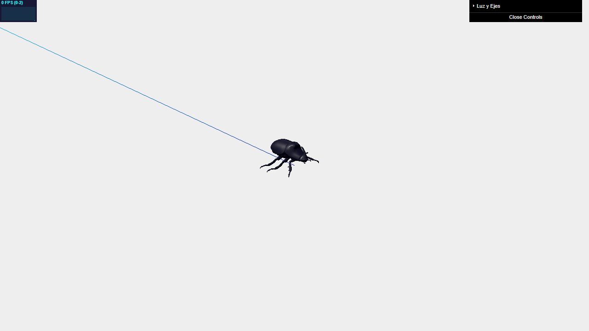
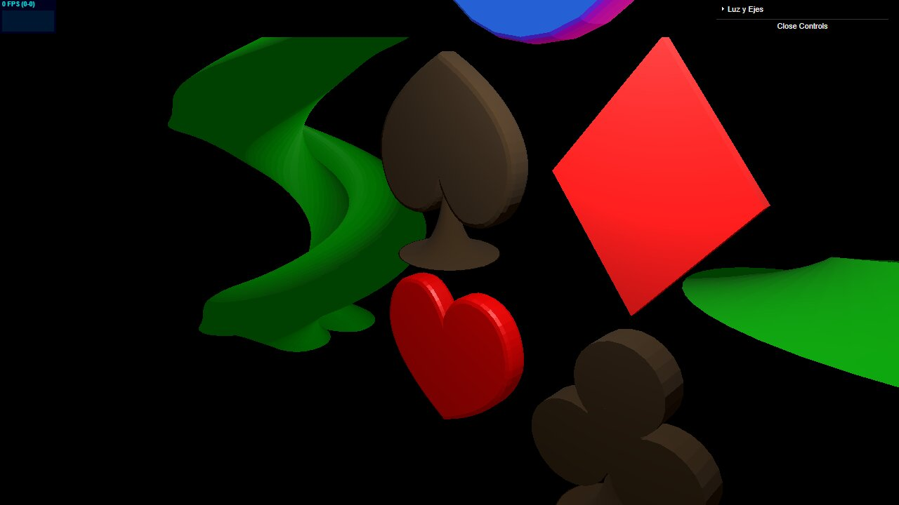
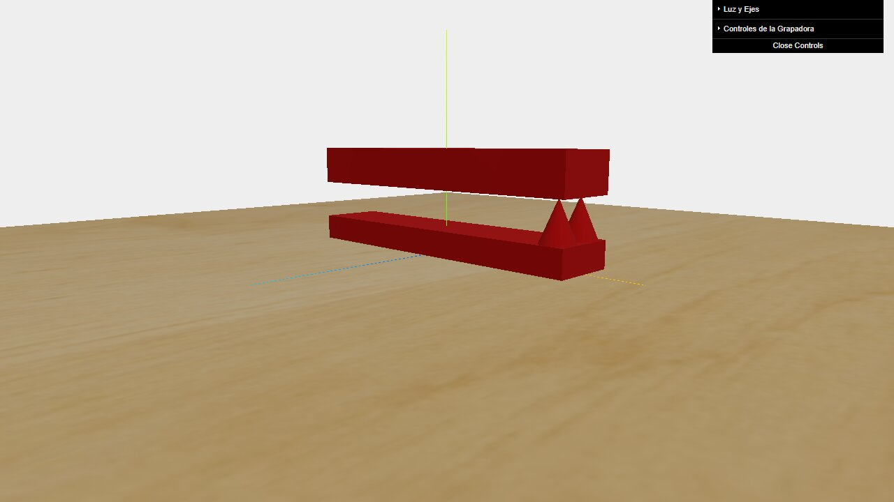

# SG · Sistemas Gráficos

Prácticas y ejercicios de **Sistemas Gráficos** (Grado en Ingeniería Informática, Universidad de Granada), hechos con **Three.js** y ejecutables directamente en el navegador.

El proyecto principal es la **Práctica 2: un ajedrez con insectos**. Es un tablero 3D en el que cada pieza es un insecto modelado y animado (hormigas, arañas, avispas, saltamontes y escarabajos). Las piezas se seleccionan con el ratón mediante *raycasting*, las casillas destino se iluminan y el turno pasa de un bando a otro con un cambio animado de luces.


## Galería

| | |
|---|---|
|  <br> *P2 · escena de combate* |  <br> *P2 · escarabajo rinoceronte* |
|  <br> *P1 · peón por revolución* |  <br> *P1 · palos de la baraja por extrusión* |
|  <br> *Grapadora articulada* |  <br> *Examen* |

Capturas tomadas ejecutando las escenas en Chrome.

## Contenido

| Carpeta | Qué hay |
|---|---|
| `P2/` | **Práctica final: ajedrez de insectos.** `SCENES/MAIN_SCENE` es el juego; el resto de `SCENES/` muestra cada insecto por separado; `FILES/` tiene las clases (`GameBoard`, `Tablero`, `Insect`, `Avispa`, `Arania`…) y modelos OBJ. Incluye la documentación y el grafo de escena en PDF. |
| `P1_FERNANDO/` | Práctica 1: geometrías básicas, revolución, extrusión, CSG, carga de modelos y el examen de la P1. |
| `practica1_adam/` | La misma práctica 1, versión de Adam Navarro. |
| `grapadora/`, `pendulos-ejemplo-teoria/`, `tween-reutilizando-animacion/`, `compartir-geometria/`, `introduccion/`, `examen/` | Ejemplos de clase y ejercicios sueltos. |
| `libs/` | Three.js y sus complementos (controles, cargadores OBJ/MTL, CSG, tween, dat.gui), incluidos en el repo para que no haga falta instalar nada. |

## Cómo ejecutarlo

Las escenas usan módulos de JavaScript, así que hay que servirlas desde un servidor local (no funcionan abriendo el `index.html` con doble clic).

1. Desde la raíz del repo, arranca el servidor que viene incluido (necesita Python 3):
   ```bash
   python3 server-launcher.py
   ```
   También vale `python3 -m http.server 8880`.
2. Abre en el navegador:
   - Ajedrez de insectos: <http://localhost:8880/P2/SCENES/MAIN_SCENE/>
   - Cualquier otra escena: `http://localhost:8880/<carpeta>/`, por ejemplo <http://localhost:8880/grapadora/>.

### Controles del ajedrez

- En el panel de la derecha, **GameBoard → [ Start Game ]** coloca las piezas y empieza la partida.
- **Clic** en una pieza de tu color para seleccionarla y **clic** en una casilla iluminada para moverla.
- **[ Pass Turn ]** pasa el turno; **Luz y Ejes** ajusta las luces y muestra u oculta los ejes.

## Autoría

Trabajo de **Fernando Lanzarot Facio** y **Adam Navarro Megías**. Copia del repositorio original [Adman23/ejerciciosThree](https://github.com/Adman23/ejerciciosThree).
