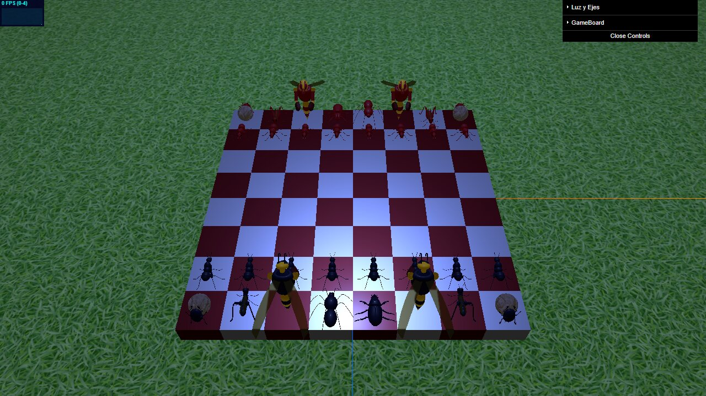
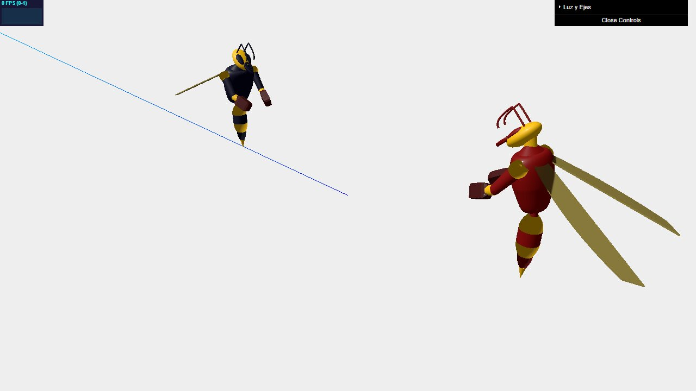
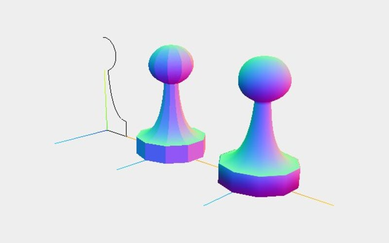
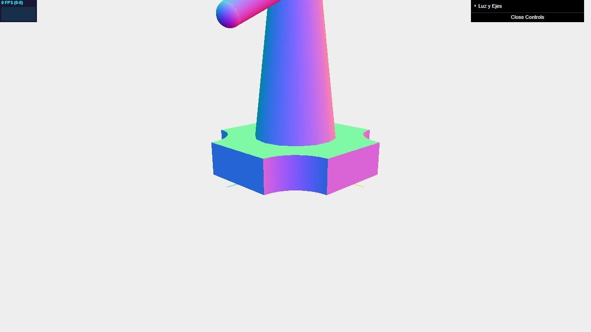

# SG · Sistemas Gráficos

Prácticas de la asignatura Sistemas Gráficos del Grado en Ingeniería Informática de la Universidad de Granada, hechas con Three.js, así que todo se ejecuta directamente en el navegador.

## Bichodrez: ajedrez de insectos (Práctica 2)

El proyecto principal es **Bichodrez**, un ajedrez en 3D inspirado en *Battle Chess*, en el que las piezas tienen vida y luchan entre ellas. En nuestro caso, todas las piezas son insectos. Las hormigas son los peones, los escarabajos peloteros las torres, los saltamontes los caballos, las avispas los alfiles, la araña es la reina y el escarabajo rinoceronte es el rey. Cinco de las piezas están modeladas por nosotros con las técnicas vistas en clase (CSG, extrusión, revolución y extrusión por curvas), y el rey es un modelo OBJ importado.

La avispa es la pieza articulada que lucha. Cuando captura, se echa hacia atrás, da dos puñetazos seguidos, uno con cada brazo, carga el aguijón, lo dispara y vuelve a su posición. Las demás piezas se mueven con una animación de giro, avance y giro de corrección, así que nunca se teletransportan, y todas las animaciones se encadenan con *tweens* y promesas para que el juego espere a que termine cada una.

Para mover una pieza, haces clic sobre ella y se iluminan las casillas a las que puede ir, y después haces clic en una de esas casillas. Para ello, se lanza un rayo desde la cámara hasta la posición del ratón (*raycasting*) y se comprueba qué pieza o casilla toca. Los movimientos de cada pieza se calculan sobre una matriz que representa el tablero. Al cambiar de turno, la cámara pasa al otro lado del tablero siguiendo una curva de Bézier y las luces cambian entre la azul (el bando blanco) y la roja (el bando negro), todo en una animación de 1,5 segundos.



| | |
|---|---|
|  |  |

## Práctica 1 y ejercicios

Antes del ajedrez, la Práctica 1 fue ir probando las distintas formas de crear geometría en Three.js. Hay figuras básicas, un peón hecho por revolución a partir de su silueta, los palos de la baraja hechos por extrusión, objetos hechos con operaciones CSG (sumar y restar sólidos, como una taza o una tuerca) y la carga de modelos OBJ.

| | |
|---|---|
|  |  |
|  |  |

Las capturas están sacadas ejecutando las escenas en Chrome.

## Cómo ejecutarlo

Las escenas usan módulos de JavaScript, así que no funcionan abriendo el `index.html` con doble clic. Hay que servirlas desde un servidor local.

1. Desde la raíz del repositorio, arranca el servidor que viene incluido (necesita Python 3):
   ```bash
   python3 server-launcher.py
   ```
   También vale `python3 -m http.server 8880`.
2. Abre en el navegador:
   - Ajedrez de insectos: http://localhost:8880/P2/SCENES/MAIN_SCENE/
   - Cualquier otra escena: `http://localhost:8880/<carpeta>/`, por ejemplo http://localhost:8880/grapadora/

## Controles del ajedrez

- **GameBoard -> [ Start Game ]:** coloca las piezas y empieza la partida
- **Clic en una pieza:** seleccionarla y ver sus movimientos
- **Clic en una casilla iluminada:** mover la pieza
- **[ Pass Turn ]:** pasar el turno
- **Luz y Ejes:** cambiar la intensidad de las luces y mostrar u ocultar los ejes

## Documentación

Todo está en `P2/`:

- **[DOCUMENTACIÓN P-FINAL.pdf](P2/DOCUMENTACI%C3%93N%20P-FINAL.pdf)** · La memoria de Bichodrez. Explica la estructura del proyecto como un MVC (la escena es la vista y `GameBoard` el controlador), cómo está modelada cada pieza y con qué técnica, y los algoritmos más importantes: cómo se calculan los movimientos posibles sobre la matriz, cómo se hace el movimiento esperando a que termine la animación, la selección con *raycasting* y el cambio de cámara y luces al pasar el turno. Termina con las ocho animaciones del combate de la avispa, una por una.
- **[planteamiento_inicial.pdf](P2/planteamiento_inicial.pdf)** · La propuesta que entregamos al principio, con el nombre del juego, qué pieza iba a luchar y cómo sería esa lucha.
- **[GRAFO DE ESCENA](P2/GRAFO%20DE%20ESCENA_250526_142859.pdf)** · El grafo de escena de las piezas.
- **[SG.drawio.pdf](P2/SG.drawio.pdf)** · El diagrama de clases.

## Estructura

```
P2/
├── SCENES/MAIN_SCENE/   <- Bichodrez
├── SCENES/*Scene/       <- cada insecto por separado
├── FILES/               <- clases del juego (GameBoard, Tablero, Insect...) y de cada insecto
└── *.pdf                <- documentación y grafo de escena
P1_FERNANDO/             <- Práctica 1: geometría básica, revolución, extrusión, CSG y modelos
practica1_adam/          <- la Práctica 1 de Adam
grapadora/, examen/...   <- ejemplos de clase y ejercicios sueltos
libs/                    <- Three.js y sus complementos, incluidos para no tener que instalar nada
```

## Créditos

Fernando Lanzarot Facio y Adam Navarro Megías. Copia del repositorio original [Adman23/ejerciciosThree](https://github.com/Adman23/ejerciciosThree).
